[English](README.md) | 한국어

# SimRep — SIMION보다 빠른 네이티브 이온 광학 시뮬레이터

SimRep은 전극이 만드는 전기장을 계산하고, 그 안에서 이온이 어떻게 날아가는지 보여 주는 프로그램입니다.
SIMION-2024가 하는 핵심 일을 하되, **같은 정밀도에서 더 빠르게**, **전극 표면은 더 정확하게** 계산하도록 새로 만들었습니다.

- 계산 코어는 Rust로 만들었고, CPU는 멀티코어, GPU는 wgpu(Vulkan/DX12)를 씁니다.
- 기존 SIMION 파일(PA, GEM, FLY2, ION, 작업대)을 그대로 엽니다.
- 데스크톱 앱, 명령행 도구 `simrep`, Python 패키지 `simrep` 세 가지 방법으로 쓸 수 있습니다.


> 자세한 설명과 검증 근거는 기술 보고서 [`docs/report/build/simrep-technical-report.pdf`](docs/report/build/simrep-technical-report.pdf)에 있습니다(한국어, 39쪽). 기존 벤치마크 수치는 그 보고서에서 가져왔고, 이후 재구성 비교는 아래 검증 기록에 구분했습니다.

---

## 무엇이 다른가요?

SIMION은 전극을 격자 칸 크기의 **계단**으로 깎고, 전위를 SOR 반복으로 풀고, 전기장을 선형 보간으로 읽습니다.
SimRep은 SIMION의 방식을 그대로 옮기지 않았습니다.

| | SIMION | SimRep |
|---|---|---|
| 전극 경계 | 격자 칸 단위 계단 | 실제 표면 위치를 반영하는 **cut-cell(표면 맞춤)** |
| 전위 풀이 | SOR 반복, 변화량으로 수렴 판정 | **멀티그리드**, 방정식 잔차로 수렴 판정 |
| 전기장 | 선형 보간(칸 경계에서 끊김) | 칸 경계에서도 **매끄러운** 5차 재구성 |
| 전극 충돌 | 계단 모양 | 원래 형상과의 **정확한 교점** 계산 |
| 계산 장치 | CPU | CPU 멀티코어 + GPU, `--device auto`는 측정한 기준으로 선택(현재 자기장 비행은 항상 CPU) |

---

## 얼마나 빠른가요?

비교 규칙은 두 가지입니다.

1. **정밀도를 맞춘 뒤** 비교합니다. 정확도는 촘촘한 격자로 푼 기준해로 판정하고, SIMION 결과도 같은 기준해에 댑니다.
2. **실제 계산 시간만** 비교합니다. 파일 읽기나 GPU 초기화 같은 준비 시간은 빼고 참고로만 적습니다.


| 비교 | 정확도 | SIMION 대비 속도 |
|---|---|---|
| 1,737만 점 3D 전위 계산 (GPU) | 엄격 설정 SIMION과 최대 6.42e-5 V 차이 | **19.3배** (준비 포함 9.1배) |
| einzel 렌즈 이온 비행 | 오차가 4.9배 작음 | 기본 품질 SIMION보다 **11.5배** |
| 3D 4중극, 정확한 표면 경로 (이전 재구성) | 도착 위치 오차 약 700배 감소 | **71배** |
| 중성 기체 충돌 HS1 / SDS | 분포 검정 통과 | **54배 / 251배** |
| 자기장 예제 7개 | 기존 정확도 기준 통과 | 1.4~48.7배 |

4중극 행은 `pre-2026-10-28 reconstruction`의 보존 측정이며, 그 재구성의 RMS는 **0.0034 mm**였습니다.
현재 코드는 유지한 이전 `8x` 기준해에 대해 **0.00386 mm**, 새로 재구성한 `8x` 기준해에 대해 **0.00388 mm**입니다.
새 기준해의 `4x`/`8x` 정련 차이는 **0.00055 mm**이므로, 이 차이를 독립적으로 확정한 물리 오차의 악화로 해석하지 않습니다.
표면 가까운 분석기 궤도의 정확도 향상과 이 내부 4중극 지표의 기준해 민감도는 [재구성 검증 기록](docs/validation/CUT_GHOST_FILL.md)에 함께 적었습니다.

정밀도를 맞춘 24개 비교에서 모두 SimRep이 빨랐습니다(1.4~251배).
측정 장비는 Ryzen 9 5950X와 RTX 3070입니다. 비교마다 시간에 넣은 범위가 조금씩 다르며, 보고서 8장과 그림 22에 적어 두었습니다.

### 정확도: 계단 대신 실제 표면

3D 4중극에서 이온 1,000개의 도착 위치 오차를 누적 분포로 그린 그림입니다. 곡선이 왼쪽에 있을수록 정확합니다.
주황은 SIMION, 회색은 같은 전위장에서 충돌만 계단형으로 판정한 SimRep, 파랑은 전위와 충돌 모두 실제 표면을 쓴 SimRep입니다.


### 적용 사례: 정전 에너지 분석기(ESA)의 에너지 채널

실제 장비의 STEP 모델을 그대로 가져와 토로이드 정전 분석기 두 구간의 전위를 풀고, 판 전압을 32개 로그 채널로 바꿔 가며 전자를 날려 채널별 통과 에너지를 구했습니다. 형상은 CAD 단면을 그대로 쓴 축대칭 모델이고, 격자 간격은 0.125 mm, 점마다 전자 4,096개입니다.

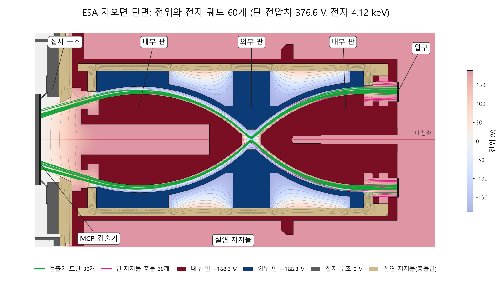

축대칭 단면의 전위(색과 등전위선)와 판 전압차 376.6 V에서 날린 4.12 keV 전자 궤도 60개입니다. 초록 30개는 MCP 검출기에 닿고 분홍 30개는 판이나 지지물에 막힙니다. SimRep으로 계산·렌더링.

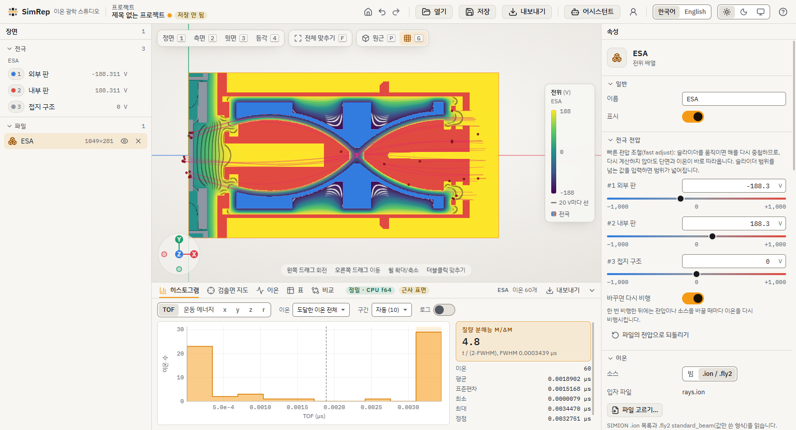

같은 전위 배열을 데스크톱 앱에서 열고, 같은 전압과 같은 전자 60개를 정밀 모드(CPU 배정밀도)로 날린 화면입니다. SimRep으로 계산·렌더링.

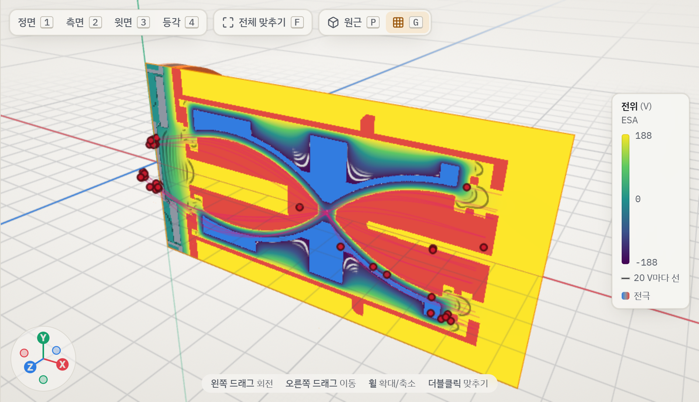

같은 비행을 비스듬히 본 3D 화면으로, 축대칭 단면을 회전해 그린 전극과 궤도가 보입니다. SimRep으로 계산·렌더링.

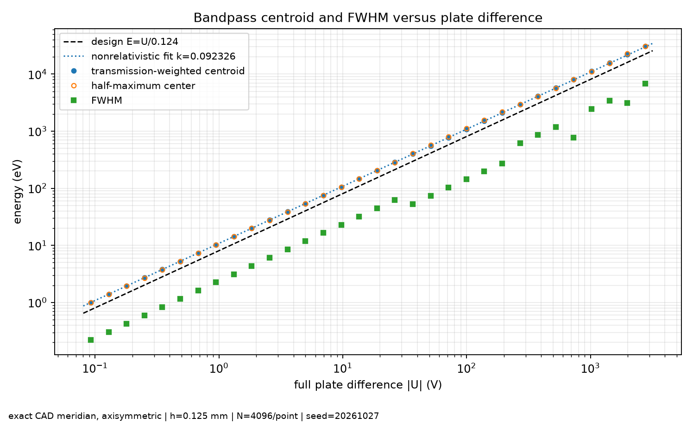

- 통과 에너지는 판 전압차에 비례합니다. 맞춘 분석기 상수는 k = 0.0923 V/eV이고, 판 간격에서 기하적으로 구한 값은 0.100 V/eV입니다.
- 채널별 분해능 FWHM/E는 0.10~0.22입니다. 이 값은 표본 수와 격자에 따라 움직여서, 수치 오차를 감안해 읽어야 합니다.

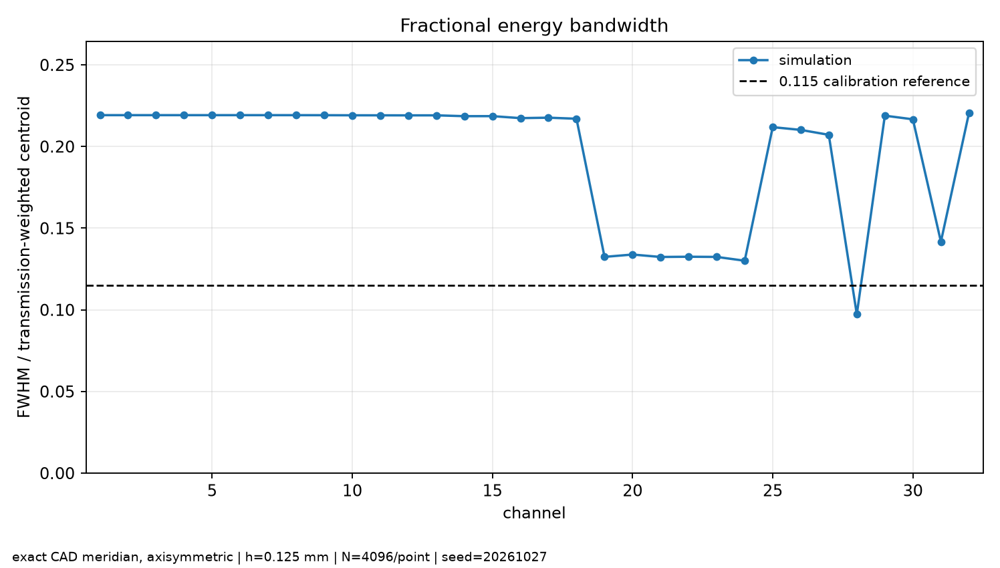

표면 근처 전기장 재구성을 고친 뒤 대표 채널을 다시 계산했습니다. 판에 가까운 궤도의 편향이 줄었지만 k는 0.0928 V/eV로 거의 같았습니다. 이 결과는 기존 채널 결론이 재구성 결함 때문이 아니었다는 뜻입니다.

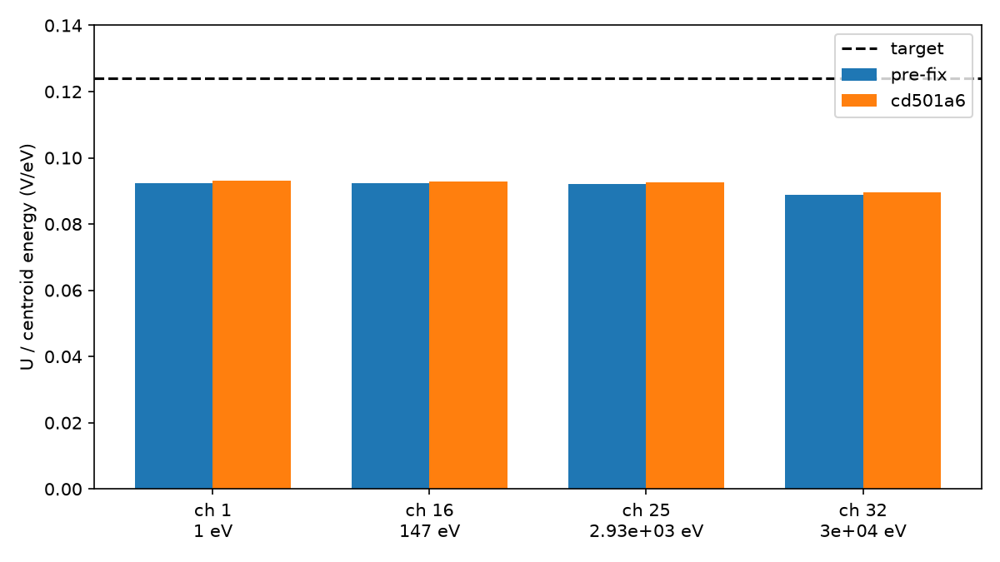

같은 모델에서 판 반지름과 슬릿을 바꿔 보는 설계 탐색도 했습니다. 판 간격을 약 3.15 mm로 넓히면 k = 0.1243 V/eV로 설계 목표 0.124 V/eV와 0.25% 차이로 맞습니다. 다만 최적화는 수렴하지 않았고, 소스의 위치·크기와 3D 구조가 정해지지 않아 제작용 설계는 아닙니다. 장비 형상과 원자료는 이 저장소에 넣지 않았습니다.

#### SIMION 2024와 같은 모델로 비교

SIMION 2024에도 같은 계단형 전위 배열(격자 0.125 mm 정규화본)과 같은 전자 소스 4,096개를 넣고, 상대론 효과를 켠 채 같은 검출면까지 날렸습니다. 두 프로그램 모두 전위를 엄격하게 수렴시켜, 채널 26 전압에서 전체 격자의 전위 차이는 최대 20.3 µV입니다.

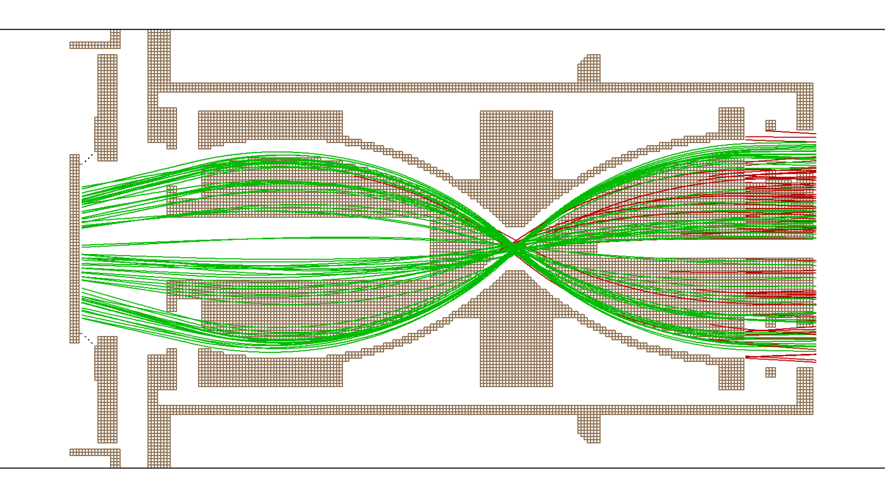

SIMION 2024 화면입니다. 같은 전자 중 SIMION 검출 60개 전부와 비검출 60개를 날린 뒤 `simion.print_screen()`으로 저장하고 그림 영역만 잘랐습니다. 초록은 검출면에 닿은 궤도, 빨강은 판이나 지지물에 막힌 궤도, 갈색은 전극입니다. SIMION으로 계산·렌더링.

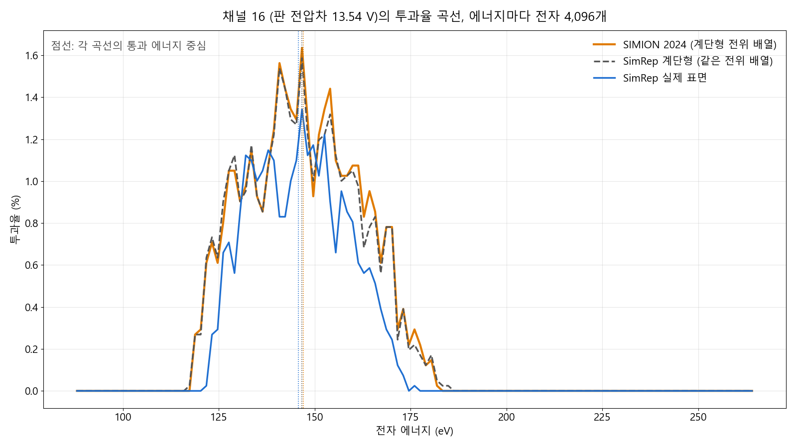

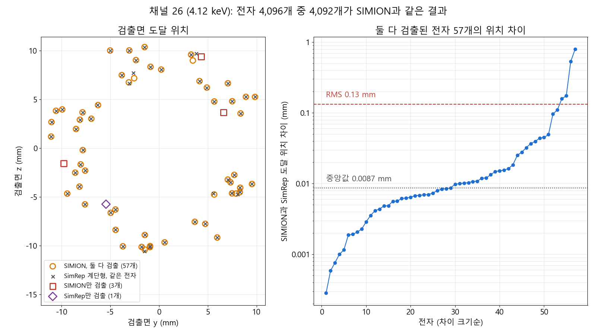

- 채널 26에서 전자 4,096개 중 4,092개가 SIMION과 같은 결과(검출 또는 충돌)였습니다. 나머지 4개는 SIMION만 검출 3개, SimRep만 검출 1개입니다.
- 둘 다 검출한 57개의 검출 위치 차이는 RMS 0.13 mm입니다.
- 채널 1, 16, 32의 통과 에너지 중심은 SIMION과 SimRep 계단형이 0.3~0.5% 안에서 맞습니다. 계단형 FWHM은 SIMION보다 7.6~8.2% 좁습니다.
- SimRep 실제 표면의 FWHM은 SIMION보다 19~35% 좁습니다.

실제 표면 결과가 좁은 주된 이유는 절연 지지물에서도 전자를 막기 때문입니다. 계단형 전위 배열에는 절연체 노드가 없어서, 전위 배열 기반인 SIMION과 SimRep 계단형은 이 지지물을 표현하지 못하고 전자가 그대로 지나갑니다. SIMION과 SimRep 계단형끼리는 서로 맞습니다. 실제 표면 계산에서 지지물 충돌만 빼면 FWHM과 검출 수가 계단형 결과로 돌아옵니다. 아래는 격자 0.0625 mm에서 채널마다 전자 495,616개를 날린 FWHM과 검출 수입니다.

| 채널 | SimRep 계단형 | SimRep 실제 표면 | 실제 표면, 지지물 충돌 제외 |
|---:|---:|---:|---:|
| 1 | 0.261 eV, 1,529개 | 0.174 eV, 1,101개 | 0.258 eV, 1,531개 |
| 16 | 38.2 eV, 1,527개 | 25.8 eV, 1,114개 | 38.1 eV, 1,537개 |
| 32 | 7,871 eV, 1,591개 | 5,611 eV, 1,121개 | 7,980 eV, 1,580개 |

채널 32의 FWHM은 표본 수에 따른 불확도가 커서, 실제 표면 FWHM의 bootstrap 표준편차가 1,728 eV입니다. MCP `analyzer_scan`은 전압 사이의 입자를 함께 bootstrap하여 중심 에너지·FWHM·FWHM/E의 표본 불확도를 보고합니다. 스캔 간격·격자 오차와는 별개입니다. 자세한 내용은 [분석기 진단](mcp/README.md#analyzer-voltage-convention)을 보세요.

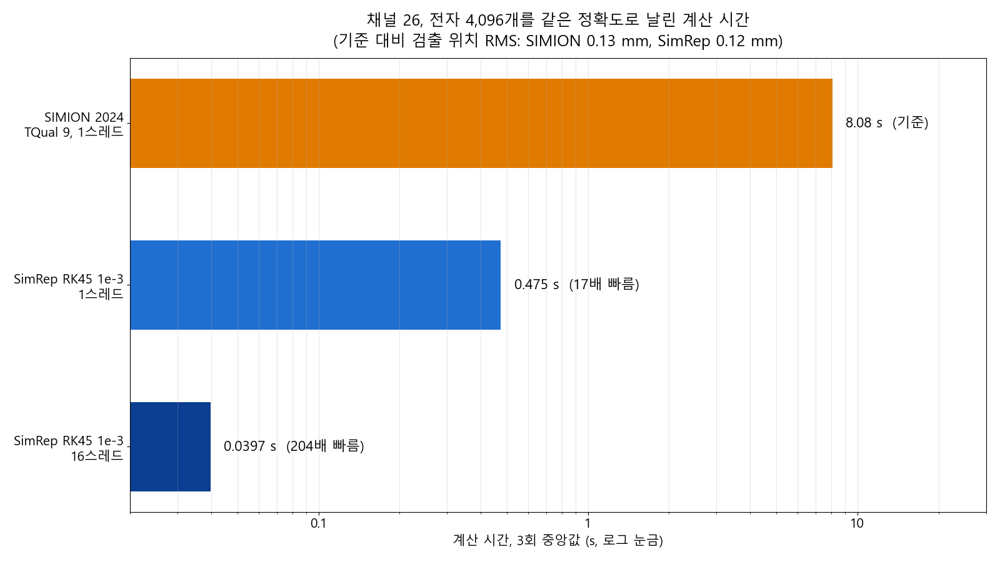

| 실행 (채널 26, 전자 4,096개) | 계산 시간 (3회 중앙값) | SIMION 대비 |
|---|---:|---:|
| SIMION 2024, 궤도 품질 9, 1스레드 | 8.08 s | 1배 |
| SimRep RK45 허용오차 1e-3, 1스레드 | 0.475 s | 17배 |
| SimRep RK45 허용오차 1e-3, 16스레드 | 0.040 s | 204배 |

SIMION은 Lua 사용자 프로그램과 기록을 끄고 한 스레드로 날렸고, SimRep은 같은 계단형 충돌로 날렸습니다. 파일 읽기와 준비를 뺀 계산 시간만 비교했습니다. 두 설정은 RK45 1e-11 기준 대비 검출 위치 RMS가 SIMION 0.13 mm, SimRep 0.12 mm로 같은 수준입니다. 측정 중 다른 작업이 CPU 코어 하나를 쓰고 있었습니다.

---

## 데스크톱 앱

템플릿을 고르거나 SIMION 파일을 열면, **형상 → 전기장 계산 → 전압·입자 설정 → 비행 → 결과**가 한 화면에서 이어집니다.


- **실시간 슬라이더**: 전극 전압을 끄는 동안 GPU가 이온을 계속 다시 날려 결과를 바로 보여 줍니다.

  

- **5단계 따라하기**: 처음 쓰는 사람을 위해 실제 템플릿으로 전압 조정, 비행, TOF 히스토그램, CSV 내보내기를 안내합니다.

  

- **정확한 표면 표시**: 계산에 실제 표면을 썼는지(정밀 모드, CPU 배정밀도), 실시간 미리보기(GPU 단정밀도)였는지 배지로 알려 줍니다.

  

- 한국어/영어, 밝은·어두운·시스템 테마, 되돌리기/다시 하기, 변경 후 1.5초 자동 저장을 지원합니다.
- **비행 결과 저장**: 프로젝트 v2는 프로젝트(`X.simrep`) 옆 `X.simrep.d/runs/`에 실행마다 이온별 결과·궤적·설정을 저장합니다. 다시 열 때 배열과 설정이 같으면 비행 없이 저장된 결과를 보여 주고, 다르면 다시 비행합니다. 형식은 [`docs/project-format.md`](docs/project-format.md)에 있습니다.
- **실행 기록·비교**: 결과 패널의 **기록** 탭에 끝난 비행이 쌓입니다(기본 최근 50개, 고정한 실행은 지우지 않음). 이름·메모·고정·삭제를 할 수 있고, 두 실행을 골라 히스토그램·검출면 지도와 설정 차이를 비교합니다.
- **AI 대화 기록·보고서**: 프로젝트와 함께 대화를 저장하고 다시 열 수 있습니다. 실행 요약·그림·비교를 HTML 보고서로 내보내고 인쇄/PDF로 저장할 수 있습니다. 자세한 내용은 [프런트엔드 문서](docs/dev/frontend.md)를 보세요.
- STL·OBJ·PLY·3MF·glTF 메시와 STEP·IGES CAD 모델을 전극으로 가져올 수 있습니다.
- 화면 검수 기록(42개 화면, 밝은·어두운 테마, 1280·1920 폭)은 [`docs/report/visual-qa/REPORT.md`](docs/report/visual-qa/REPORT.md)에 있습니다.

### 설치 (Windows)

Windows용 설치 파일은 **관리자 권한 없이** 사용자 계정에 설치되는 NSIS 패키지(약 28.5 MiB)입니다.
STEP/IGES 가져오기용 OpenCascade 라이브러리와 Visual C++ 런타임이 들어 있습니다.
설치 파일을 만드는 방법은 [`docs/dev/frontend.md`](docs/dev/frontend.md)의 "Windows 설치 패키지" 절을 보세요.

GPU 기능에는 WebGPU/Vulkan 또는 DX12를 지원하는 그래픽 카드가 필요합니다. GPU가 없으면 CPU로 계산합니다.

---

## AI 도우미

데스크톱 앱 오른쪽의 **어시스턴트** 패널에서 ChatGPT, Claude 같은 AI와 한국어 또는 영어로 대화하며 SimRep을 움직일 수 있습니다.
AI는 SimRep MCP 도구(`pa_info`, `refine`, `fly`, `summarize_results` 등)를 직접 불러 전기장을 풀고 이온을 날린 뒤 결과를 요약합니다.
요금은 각자의 구독 계정으로 로그인해서 그 요금제로 처리합니다.

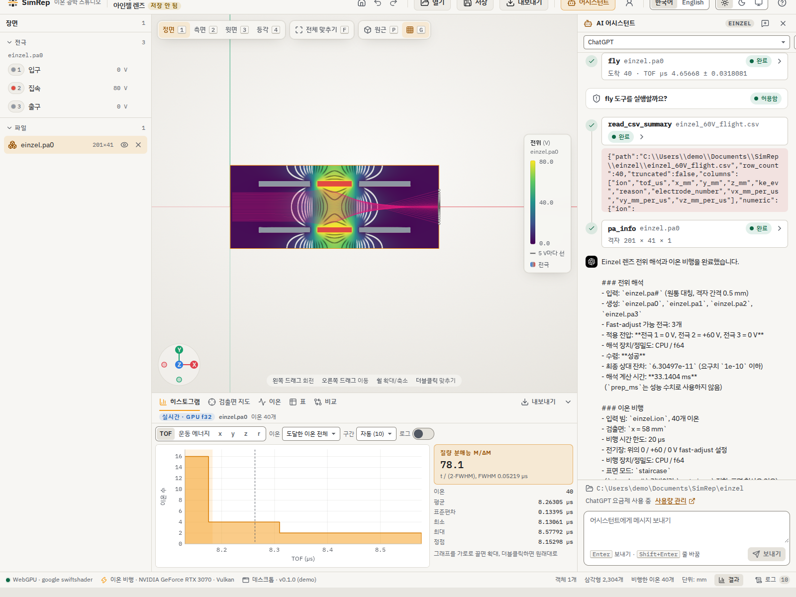

위 화면은 실제 ChatGPT 계정으로 "einzel 렌즈 전위 계산하고 이온 날려줘"라고 요청한 결과입니다.
모델이 `simrep_plan`과 `pa_info`로 파일을 확인하고, 승인을 받아 `refine`과 `fly`를 실행한 뒤, 결과 CSV를 읽어 수렴 여부, 검출면 도달 수, TOF를 한국어로 정리했습니다.
3D 뷰와 히스토그램은 앱이 템플릿 설정으로 날린 결과이고, AI는 같은 폴더에서 자기 설정으로 따로 날렸습니다.

- **승인 모드: 묻기 / 이 대화에서는 모두 허용 / 승인 생략(ask / allow all in chat / bypass).** 묻기 모드에서는 `refine`, `fly`, 내보내기처럼 프로젝트 폴더에 쓰는 도구를 승인 카드에서 허용해야 실행되고, 답하지 않으면 2분 뒤 거부됩니다. 읽기 전용 도구만 바로 실행됩니다. "이 대화에서는 모두 허용"이나 "승인: 묻지 않기"를 고르면 확인 클릭 없이 실행되지만 "승인 생략 중" 표시와 "자동" 표시가 남고, 모든 모드에서 작업 폴더 안의 SimRep 도구만 쓸 수 있다는 제한은 그대로입니다.

  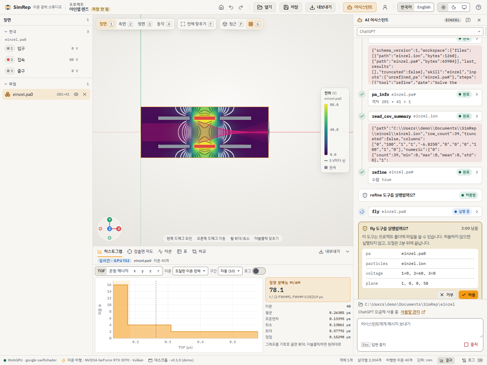

- **토큰은 로컬 브리지에만 있고 앱 창에는 전달되지 않습니다.** 로그인은 시스템 브라우저에서 하고, 토큰은 로컬 AI 브리지(`ai/`)만 갖습니다. 앱 창(WebView)에는 계정 표시 이름과 대화·도구 이벤트만 전달됩니다. AI는 셸이나 임의 파일 접근 없이, 프로젝트 폴더로 제한된 SimRep 도구만 씁니다.

  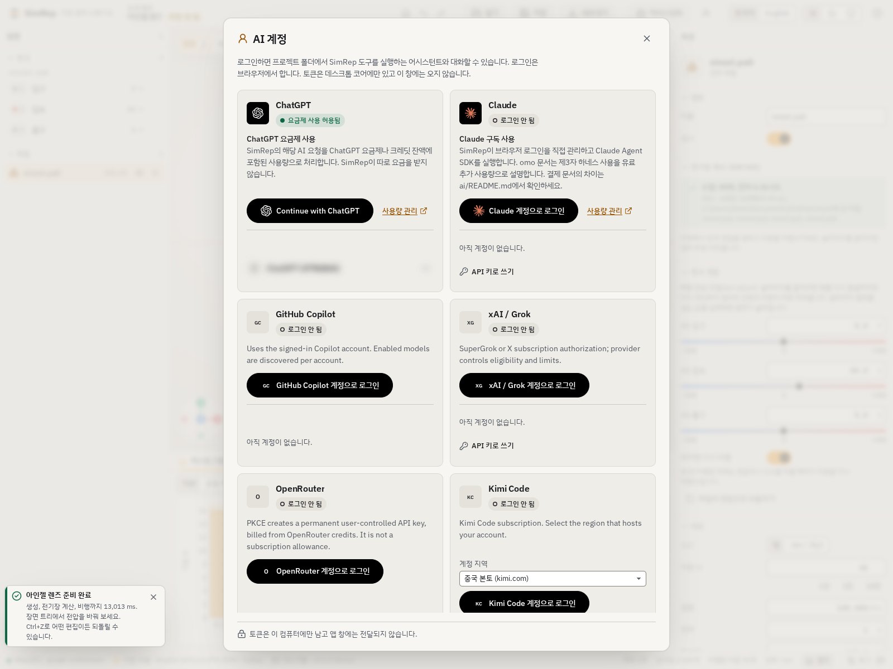

- **제공자**: 구독 로그인(OAuth)은 ChatGPT, Claude, GitHub Copilot, xAI(Grok), Kimi Code, Devin, Meta, Kiro, OpenRouter를 지원합니다. Cursor와 Radius는 로그인만 되고 대화에는 아직 쓸 수 없습니다. OpenAI, Gemini, DeepSeek, Mistral 등은 환경 변수의 API 키로 쓸 수 있으며, 이때는 구독이 아니라 API 사용량으로 과금됩니다.
- **하네스**: 모든 제공자가 같은 시스템 프롬프트(단위, 장치 규칙, PA 파일 구성, 검증 규칙)를 받습니다. einzel, ESA, 4중극, 자기장, CAD 같은 작업 레시피는 요청에 맞는 것만 그때 불러옵니다. 상위 도구 `analyzer_scan`, `grid_convergence`, `check_geometry`, `compare_runs`로 에너지 분석기 스캔, 격자 수렴(u_num), 형상 틈 검사, 결과 비교를 한 번에 맡길 수 있습니다. 답변의 속도 수치는 실제 도구 결과의 `compute_ms`와 맞는지 확인하고, 폴백·미수렴 같은 문제에는 `[verify]` 메모를 붙입니다.
- **예산을 정한 설계 탐색**: MCP `optimize_design`은 재개 가능한 GEM 설계 루프를 정해진 예산 안에서 실행합니다. 예산을 다 쓰면 후보(candidate)를 반환할 뿐, 최적해(optimum)가 증명된 것은 아닙니다. 자세한 내용은 [MCP 도구 문서](mcp/README.md)를 보세요.
- **시작하기**: `ai/`에서 `npm ci`로 브리지를 설치하고 SimRep CLI를 빌드한 뒤 앱을 띄웁니다. 상단 바의 계정 버튼에서 로그인하고 **어시스턴트**를 엽니다. 자세한 설치와 제공자별 설명은 [`ai/README.md`](ai/README.md), 하네스 구조는 [`ai/harness/README.md`](ai/harness/README.md)에 있습니다.
- **한계**: 자동 테스트는 가짜 서버로 로그인·도구 흐름을 검증할 뿐, 각 제공자의 실제 계정 로그인과 요금제 권한은 사용자가 직접 확인해야 합니다. 어떤 모델을 쓸 수 있는지는 제공자와 계정 요금제가 정합니다. 제공자 약관과 과금 방식은 [`ai/README.md`](ai/README.md)의 "Providers, billing and availability" 절을 따릅니다.

---

## 명령행 도구 `simrep`

```sh
# 빌드 (저장소 루트에서)
cargo build --release -p simrep-cli

# 도움말
./target/release/simrep --help
```

STEP/IGES CAD 가져오기는 OpenCascade(OCCT)가 필요하고 기본 빌드에는 들어 있지 않습니다.
`cargo build --release -p simrep-cli --features cad`로 빌드하세요. 상세는 [`docs/step-import.md`](docs/step-import.md)에 있습니다.
Windows 설치 파일에는 CAD 기능이 이미 포함되어 있습니다.

자주 쓰는 명령(파일 이름은 예시입니다):

```sh
# SIMION GEM 파일을 전위 배열(PA#)로 변환 (GEM 안의 Lua 전처리 포함)
simrep gem2pa quadrupole.gem

# 전위 계산(refine). auto는 유전체 재료가 있을 때만 측정한 교차점 기준으로 GPU를 쓰고,
# 이런 일반 정전기 입력은 CPU로 돕니다. GPU 19.3배 결과 재현에는 --device gpu가 필요합니다
simrep refine quadrupole.pa#

# GEM·메시·CAD 형상을 실제 표면 그대로 풀고, 정확한 표면 파일(.cuts.json)까지 만들기
# GEM에서는 --electrode 소스전극값=전극번호:전압 형식으로, 파일 안의 모든 전극에 정확히 하나씩 지정합니다
simrep refine-geometry bench/quadrupole.gem --electrode 1=1:2.5 --electrode 2=2:-2.5 --electrode 3=3:0 --out quadrupole
# 메시·CAD 입력에서는 소스전극값 대신 부품 이름(이름이 없으면 인덱스)을 씁니다
# 예: simrep refine-geometry housing.stl --grid 121,37,37 --electrode housing=1:2.5 --out housing

# 이온 비행: 전극 전압을 바꿔 가며 날리기 (.cuts.json이 옆에 있으면 자동으로 씀)
simrep fly --pa quadrupole.pa0 --particles ions.ion --voltage 1=2.5,2=-2.5

# 전위장·궤적을 VTK/CSV 등으로 내보내기
simrep export grid quadrupole.pa0 field.vti
```

- **표본 SDF 표면 백엔드(실험적)**: `--surface-backend sdf --device gpu`로 원래 형상의 충돌 표면을 근사한 GPU 비행을 할 수 있고, CPU SDF도 지원합니다. 보고되는 인증된 보간 오차 상한은 근사 오차를 설명하며 정확한 교점 계산을 뜻하지 않습니다. **CPU exact가 기준**입니다. 기본값은 `exact`이며, 명시적으로 고르는 `--surface-backend auto`도 현재는 CPU exact를 선택합니다. [RTX 3070 측정과 교차점 정책](docs/dev/sdf-auto-crossover.md)을 보세요.
- **이식 가능한 비행 분할**: `fly --shard i/N`으로 독립 이온 비행을 여러 프로세스·GPU·PC에 MPI 없이 나누고 `simrep merge-flights out.csv a.csv b.csv`로 합칩니다. 원본 인덱스·난수를 보존하며, JSON 사이드카와 동일한 입력·설정·백엔드·정밀도를 유지하면 같은 수치 경로의 미분할 실행과 CSV 바이트가 같습니다. 공간전하·beam 모드는 제외됩니다. GPU 선택은 `--device gpu --gpu-adapter 이름또는인덱스`, Python 병합은 `simrep.merge_flights(output, shards)`입니다. [비행 분할 문서](docs/python.md#merging-portable-flight-shards)를 보세요.
- **개구 폭 검사**: `aperture-check`는 탐침 선을 따라 계단형·유효·정확한 개구 폭을 비교합니다. [Python/CLI 대응표](docs/python.md#aperture-checks)를 보세요.
- **충돌 전용 절연체**: `refine-geometry --insulator PART`는 전위 경계 없이 충돌 형상만 지정합니다. 계단형 비행에서 `--no-cuts --surface-collisions insulators|all`로 원하는 충돌 표면을 추가하며, GPU에서는 SDF가 필요합니다. [충돌 전용 절연체 문서](docs/python.md#collision-only-insulators)를 보세요.

그 밖에 메시 가져오기(`mesh-import`), 외부 프로그램(COMSOL, Opera 등)의 자기장 지도(`fly --bfield-map`), 시간 가변 전압(`--voltage-expr`)을 지원합니다.
각 명령의 옵션은 `simrep <명령> --help`로 볼 수 있습니다.

### `--json` 출력

자동화·AI 에이전트에서는 전역 옵션 `--json`을 명령 앞이나 뒤에 붙이세요.
정상 실행은 마지막에 JSON 객체 하나만 stdout에 쓰고, 진행 메시지는 stderr로 보냅니다.
`--help`·`--version`은 기존 텍스트를 출력합니다. 비행 CSV는 `--output`으로 파일에 저장하세요.
파일을 지정하지 않으면 JSON 모드에서는 CSV도 stderr로 갑니다.

```sh
simrep --json refine quadrupole.pa# --device cpu
simrep fly --json --pa quadrupole.pa0 --particles ions.ion --output flight.csv
```

모든 요약에는 `schema_version: 1`, `simrep_version`이 있습니다.
비행은 `splat_counts`, 검출면 `arrivals`, `arrival_tof_us`(평균·모집단 표준편차·최솟값·최댓값; 도착 없으면 null)를,
전위 계산은 `cycles`, `final_residual`(상대 잔차), `tolerance`, `converged`를 반환합니다.
두 명령군은 `compute_ms`와 `prep_ms`, `requested`·`executed`, `fallback_reason`을 나눠 보고합니다.
여러 기저를 풀면 cycles는 합계, residual은 마지막 잔차 중 최댓값입니다. CPU의 실행 backend는 null입니다.
GPU 전위 계산의 `mixed-f32-f64`는 f32 보정과 f64 해·잔차를 뜻합니다.
변환·내보내기는 `output_paths`로 실제 작성 파일을 알려 줍니다.
실패하면 `{"error":{"message":"...","kind":"..."},...}` 한 객체와 종료 코드 1을 반환하고, stderr에도 오류를 남깁니다.
`error.kind`는 `invalid_arguments`, `io`, `command_failed` 중 하나입니다.

---

## Python 패키지 `simrep`

명령행 기능을 NumPy 배열로 그대로 쓸 수 있어서 매개변수 탐색과 분석에 편합니다(Python 3.10 이상).

```sh
python3 -m venv .venv && . .venv/bin/activate
python -m pip install maturin numpy scipy
maturin develop --release --manifest-path crates/simrep-py/Cargo.toml
```

```python
import simrep

field = simrep.refine("einzel.pa#")             # 전위 계산
result = simrep.fly(field, "ions.ion")          # 이온 비행
```

예제: [`crates/simrep-py/examples/einzel_scan.py`](crates/simrep-py/examples/einzel_scan.py)(einzel 전압 최적화), [`crates/simrep-py/examples/tof_scan.py`](crates/simrep-py/examples/tof_scan.py)(TOF 분해능 스캔).
명령행과 Python 함수의 대응표는 [`docs/python.md`](docs/python.md)에 있습니다.

---

## 지원하는 물리

- 정전기장(라플라스·푸아송), 원통 대칭과 3D
- 자기장: 균일장, 자기 PA, 원형·솔레노이드 코일(비오-사바르, 코일 지도), 외부 자기장 지도 가져오기
- 재료가 있는 자기장: 철심·영구자석(스칼라 포텐셜), 전류(벡터 포텐셜)
- 유전체: 선형·비선형
- 중성 기체 충돌: SIMION 예제의 HS1, SDS 모델
- 공간전하: 직접 쿨롱 합, PIC, SIMION beam 모드
- 상대론 운동, RK45 적응 적분기(선택 시 Boris)

---

## 저장소 구성

| 경로 | 내용 |
|---|---|
| `crates/` | Rust 계산 코어 11개 크레이트(솔버, 비행, 파일 입출력, GEM/Lua, 메시, CAD, CLI, Python) |
| `app/` | 데스크톱 앱(Tauri 2 + React + WebGPU) |
| `docs/` | 설계 문서와 검증 기록. 시작점은 [`docs/PLAN.md`](docs/PLAN.md), 구현된 방정식 명세는 [`docs/spec/equations.md`](docs/spec/equations.md) |
| `bench/` | SIMION과의 속도·정확도 비교 기록 |
| `docs/report/` | 최종 기술 보고서(DOCX/PDF), 그림, 출처 장부 |
| `tools/` | 빌드·비교·Windows 도구 |

개발과 검증 명령(전체 테스트, GPU 확인 등)은 [`docs/python.md`](docs/python.md)의 "WSL build and checks", [`docs/dev/windows-gpu.md`](docs/dev/windows-gpu.md), [`docs/dev/frontend.md`](docs/dev/frontend.md)에 있습니다.

---

## 알아 두면 좋은 한계

- 측정은 RTX 3070 한 대 기준입니다. 자기장 비행은 `--device auto`에서 GPU 종류와 무관하게 항상 CPU로 계산됩니다. 지원되는 조합에서는 `--device gpu`로 명시 선택할 수 있고(벡터 포텐셜과 자성 재료 경로는 CPU 전용), 일반 정전기 refine도 auto는 유전체 재료가 있을 때만 GPU를 씁니다. 다른 GPU에서 자동 선택을 바꾸려면 그 카드로 교차점을 다시 측정하고 정책을 갱신해야 합니다.
- 기본 정확한 교점 표면 백엔드는 CPU 전용입니다. 실험적 GPU 표면 비행은 표본 SDF 근사와 인증된 근사 오차 상한을 사용하며, auto는 현재 CPU exact를 유지합니다. [교차점 기록](docs/dev/sdf-auto-crossover.md)을 보세요.
- SIMION 작업대의 Lua 사용자 프로그램은 지원하지 않습니다. 시간 가변 전압과 검출은 설정과 수식으로 대신합니다.
- STEP 내보내기, 비선형 B-H 자성체는 아직 없습니다.
- 외부 자기장 지도는 규칙 격자 파일만 받습니다.
- 정확도 기준해는 촘촘한 격자로 얻은 수치 기준이며, 연속 해의 엄밀한 상한은 아닙니다.

전체 목록은 보고서 9장에 있습니다.

---

## SIMION과의 관계

SimRep은 SIMION의 코드를 쓰거나 역분석하지 않았습니다(사용권 계약이 금지합니다).
SIMION은 명령행 배치 실행 결과, 설치된 예제 파일, 공개 문서만 비교 기준으로 썼습니다.
SIMION은 Scientific Instrument Services의 제품입니다.

## 라이선스

현재 공개 라이선스가 정해지지 않은 비공개 저장소입니다(`Cargo.toml`의 `license = "UNLICENSED"`).
STEP/IGES 가져오기에 쓰는 OpenCascade는 LGPL 2.1(예외 조항 포함)이며, 고지는 설치 패키지에 함께 들어갑니다.
