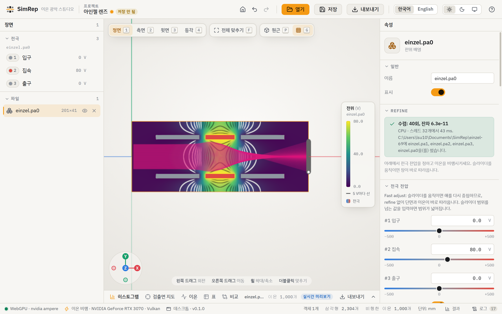
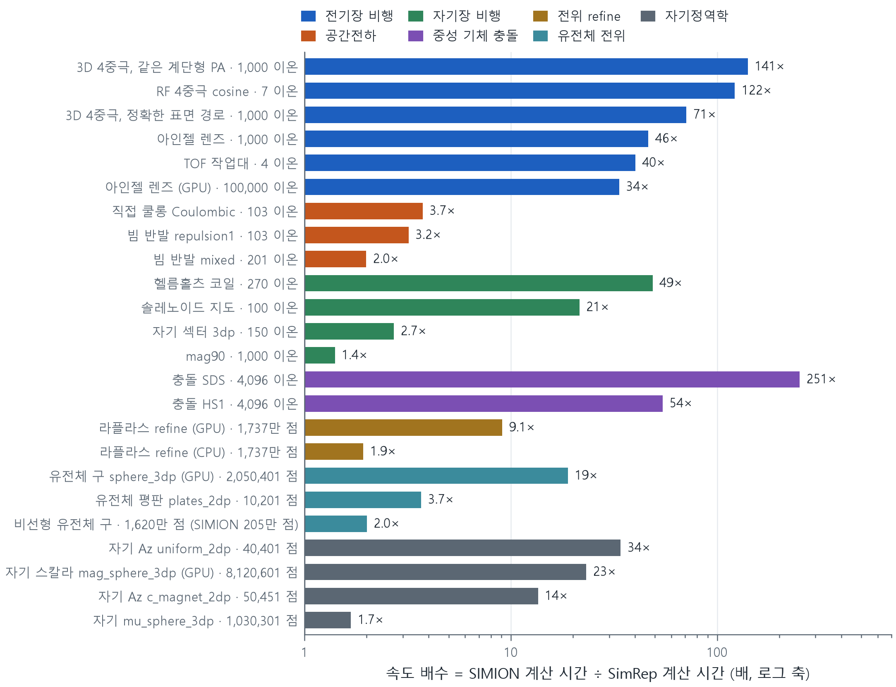
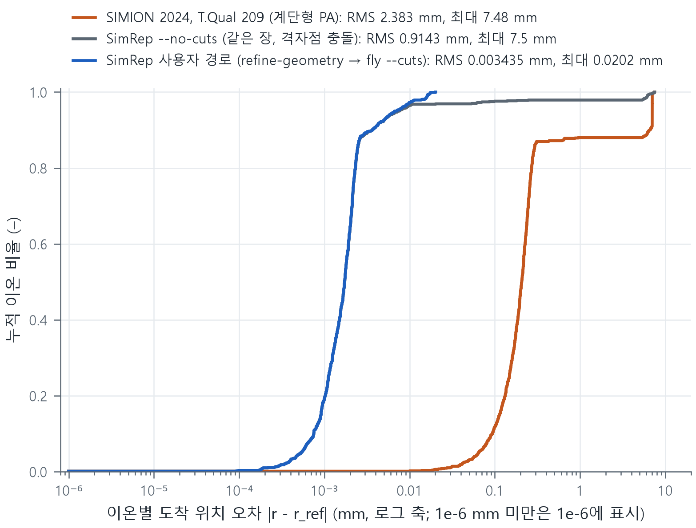
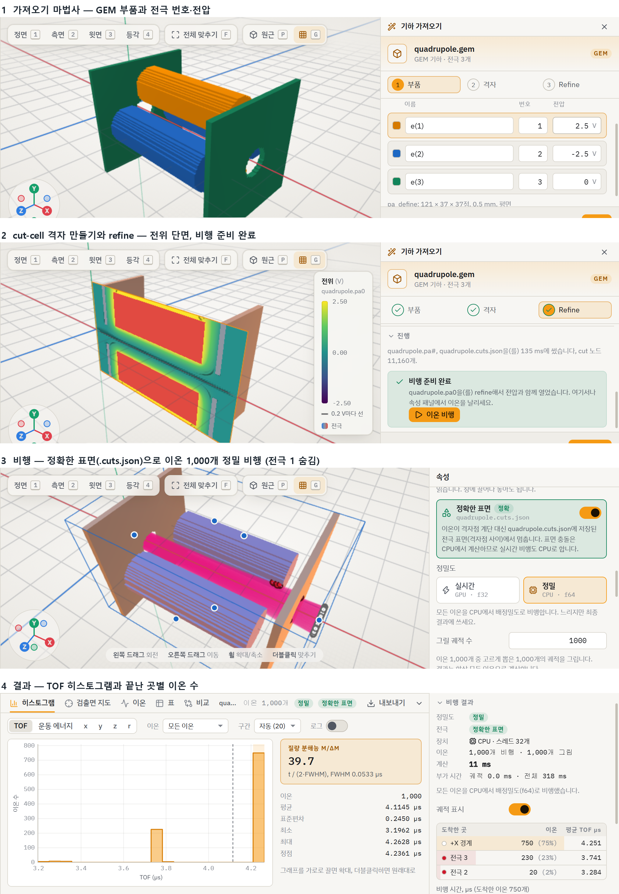
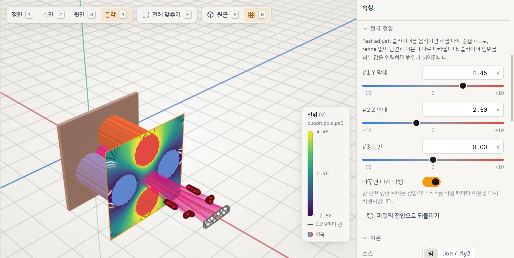
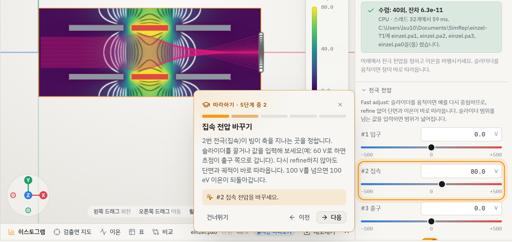
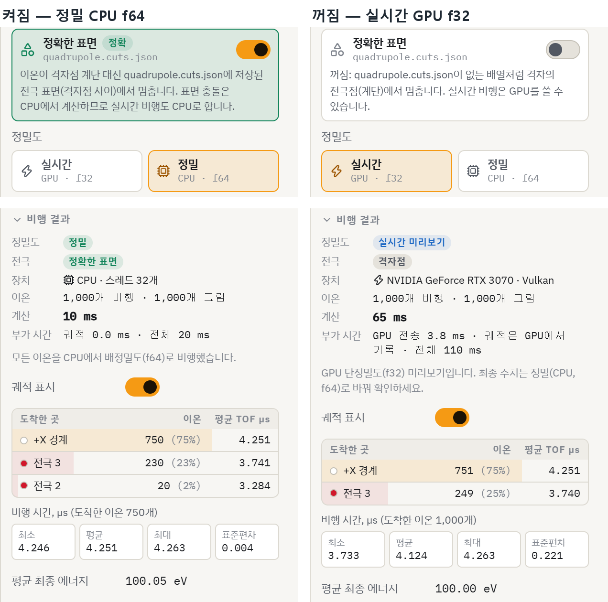

# SimRep — SIMION보다 빠른 네이티브 이온 광학 시뮬레이터

SimRep은 전극이 만드는 전기장을 계산하고, 그 안에서 이온이 어떻게 날아가는지 보여 주는 프로그램입니다.
SIMION-2024가 하는 핵심 일을 하되, **같은 정밀도에서 더 빠르게**, **전극 표면은 더 정확하게** 계산하도록 새로 만들었습니다.

- 계산 코어는 Rust로 만들었고, CPU는 멀티코어, GPU는 wgpu(Vulkan/DX12)를 씁니다.
- 기존 SIMION 파일(PA, GEM, FLY2, ION, 작업대)을 그대로 엽니다.
- 데스크톱 앱, 명령행 도구 `simrep`, Python 패키지 `simrep` 세 가지 방법으로 쓸 수 있습니다.



> 자세한 설명과 검증 근거는 기술 보고서 [`docs/report/build/simrep-technical-report.pdf`](docs/report/build/simrep-technical-report.pdf)에 있습니다(한국어, 39쪽). 이 README의 숫자는 모두 그 보고서에서 가져왔습니다.

---

## 무엇이 다른가요?

SIMION은 전극을 격자 칸 크기의 **계단**으로 깎고, 전위를 SOR 반복으로 풀고, 전기장을 선형 보간으로 읽습니다.
SimRep은 SIMION의 방식을 그대로 옮기지 않았습니다.

| | SIMION | SimRep |
|---|---|---|
| 전극 경계 | 격자 칸 단위 계단 | 실제 표면 위치를 반영하는 **cut-cell(표면 맞춤)** |
| 전위 풀이 | SOR 반복, 변화량으로 수렴 판정 | **멀티그리드**, 방정식 잔차로 수렴 판정 |
| 전기장 | 선형 보간(칸 경계에서 끊김) | 칸 경계에서도 **매끄러운** 5차 재구성 |
| 전극 충돌 | 계단 모양 | 원래 형상과의 **정확한 교점** 계산 |
| 계산 장치 | CPU | CPU 멀티코어 + GPU, 측정한 기준으로 자동 선택 |

---

## 얼마나 빠른가요?

비교 규칙은 두 가지입니다.

1. **정밀도를 맞춘 뒤** 비교합니다. 정확도는 촘촘한 격자로 푼 기준해로 판정하고, SIMION 결과도 같은 기준해에 댑니다.
2. **실제 계산 시간만** 비교합니다. 파일 읽기나 GPU 초기화 같은 준비 시간은 빼고 참고로만 적습니다.



| 비교 | 정확도 | SIMION 대비 속도 |
|---|---|---|
| 1,737만 점 3D 전위 계산 (GPU) | 엄격 설정 SIMION과 6.4e-5 V 이내 | **19.3배** (준비 포함 9.1배) |
| einzel 렌즈 이온 비행 | 오차가 4.9배 작음 | 기본 품질 SIMION보다 **11.5배** |
| 3D 4중극, 정확한 표면 경로 | 도착 위치 오차 약 700배 감소 | **71배** |
| 중성 기체 충돌 HS1 / SDS | 분포 검정 통과 | **54배 / 251배** |
| 자기장 예제 7개 | 기존 정확도 기준 통과 | 1.4~48.7배 |

정밀도를 맞춘 24개 비교에서 모두 SimRep이 빨랐습니다(1.4~251배).
측정 장비는 Ryzen 9 5950X와 RTX 3070입니다. 비교마다 시간에 넣은 범위가 조금씩 다르며, 보고서 8장과 그림 22에 적어 두었습니다.

### 정확도: 계단 대신 실제 표면

3D 4중극에서 이온 1,000개의 도착 위치 오차를 누적 분포로 그린 그림입니다. 곡선이 왼쪽에 있을수록 정확합니다.
주황은 SIMION, 회색은 같은 전위장에서 충돌만 계단형으로 판정한 SimRep, 파랑은 전위와 충돌 모두 실제 표면을 쓴 SimRep입니다.



---

## 데스크톱 앱

템플릿을 고르거나 SIMION 파일을 열면, **형상 → 전기장 계산 → 전압·입자 설정 → 비행 → 결과**가 한 화면에서 이어집니다.



- **실시간 슬라이더**: 전극 전압을 끄는 동안 GPU가 이온을 계속 다시 날려 결과를 바로 보여 줍니다.

  

- **5단계 따라하기**: 처음 쓰는 사람을 위해 실제 템플릿으로 전압 조정, 비행, TOF 히스토그램, CSV 내보내기를 안내합니다.

  

- **정확한 표면 표시**: 계산에 실제 표면을 썼는지(정밀 모드, CPU 배정밀도), 실시간 미리보기(GPU 단정밀도)였는지 배지로 알려 줍니다.

  

- 한국어/영어, 밝은·어두운·시스템 테마, 되돌리기/다시 하기, 변경 후 1.5초 자동 저장을 지원합니다.
- STL·OBJ·PLY·3MF·glTF 메시와 STEP·IGES CAD 모델을 전극으로 가져올 수 있습니다.
- 화면 검수 기록(42개 화면, 밝은·어두운 테마, 1280·1920 폭)은 [`docs/report/visual-qa/REPORT.md`](docs/report/visual-qa/REPORT.md)에 있습니다.

### 설치 (Windows)

Windows용 설치 파일은 **관리자 권한 없이** 사용자 계정에 설치되는 NSIS 패키지(약 28.5 MiB)입니다.
STEP/IGES 가져오기용 OpenCascade 라이브러리와 Visual C++ 런타임이 들어 있습니다.
설치 파일을 만드는 방법은 [`docs/dev/frontend.md`](docs/dev/frontend.md)의 "Windows 설치 패키지" 절을 보세요.

GPU 기능에는 WebGPU/Vulkan 또는 DX12를 지원하는 그래픽 카드가 필요합니다. GPU가 없으면 CPU로 계산합니다.

---

## 명령행 도구 `simrep`

```sh
# 빌드 (저장소 루트에서)
cargo build --release -p simrep-cli

# 도움말
./target/release/simrep --help
```

자주 쓰는 명령(파일 이름은 예시입니다):

```sh
# SIMION GEM 파일을 전위 배열(PA#)로 변환 (GEM 안의 Lua 전처리 포함)
simrep gem2pa quadrupole.gem

# 전위 계산(refine). 장치는 기본값 auto가 측정한 기준으로 고릅니다
simrep refine quadrupole.pa#

# GEM·메시·CAD 형상을 실제 표면 그대로 풀고, 정확한 표면 파일(.cuts.json)까지 만들기
# --electrode 부품이름=전극번호:전압 (부품 이름은 GEM/메시/CAD 파일 안의 이름)
simrep refine-geometry quadrupole.gem --electrode <부품이름>=1:2.5 --out quadrupole

# 이온 비행: 전극 전압을 바꿔 가며 날리기 (.cuts.json이 옆에 있으면 자동으로 씀)
simrep fly --pa quadrupole.pa0 --particles ions.ion --voltage 1=2.5,2=-2.5

# 전위장·궤적을 VTK/CSV 등으로 내보내기
simrep export grid quadrupole.pa0 field.vti
```

그 밖에 메시 가져오기(`mesh-import`), 외부 프로그램(COMSOL, Opera 등)의 자기장 지도(`fly --bfield-map`), 시간 가변 전압(`--voltage-expr`)을 지원합니다.
각 명령의 옵션은 `simrep <명령> --help`로 볼 수 있습니다.

---

## Python 패키지 `simrep`

명령행 기능을 NumPy 배열로 그대로 쓸 수 있어서 매개변수 탐색과 분석에 편합니다(Python 3.10 이상).

```sh
python3 -m venv .venv && . .venv/bin/activate
python -m pip install maturin numpy scipy
maturin develop --release --manifest-path crates/simrep-py/Cargo.toml
```

```python
import simrep

field = simrep.refine("einzel.pa#")             # 전위 계산
result = simrep.fly(field, "ions.ion")          # 이온 비행
```

예제: [`crates/simrep-py/examples/einzel_scan.py`](crates/simrep-py/examples/einzel_scan.py)(einzel 전압 최적화), [`crates/simrep-py/examples/tof_scan.py`](crates/simrep-py/examples/tof_scan.py)(TOF 분해능 스캔).
명령행과 Python 함수의 대응표는 [`docs/python.md`](docs/python.md)에 있습니다.

---

## 지원하는 물리

- 정전기장(라플라스·푸아송), 원통 대칭과 3D
- 자기장: 균일장, 자기 PA, 원형·솔레노이드 코일(비오-사바르, 코일 지도), 외부 자기장 지도 가져오기
- 재료가 있는 자기장: 철심·영구자석(스칼라 포텐셜), 전류(벡터 포텐셜)
- 유전체: 선형·비선형
- 중성 기체 충돌: SIMION 예제의 HS1, SDS 모델
- 공간전하: 직접 쿨롱 합, PIC, SIMION beam 모드
- 상대론 운동, RK45 적응 적분기(선택 시 Boris)

---

## 저장소 구성

| 경로 | 내용 |
|---|---|
| `crates/` | Rust 계산 코어 11개 크레이트(솔버, 비행, 파일 입출력, GEM/Lua, 메시, CAD, CLI, Python) |
| `app/` | 데스크톱 앱(Tauri 2 + React + WebGPU) |
| `docs/` | 설계 문서와 검증 기록. 시작점은 [`docs/PLAN.md`](docs/PLAN.md) |
| `bench/` | SIMION과의 속도·정확도 비교 기록 |
| `docs/report/` | 최종 기술 보고서(DOCX/PDF), 그림, 출처 장부 |
| `tools/` | 빌드·비교·Windows 도구 |

개발과 검증 명령(전체 테스트, GPU 확인 등)은 [`docs/python.md`](docs/python.md)의 "WSL build and checks", [`docs/dev/windows-gpu.md`](docs/dev/windows-gpu.md), [`docs/dev/frontend.md`](docs/dev/frontend.md)에 있습니다.

---

## 알아 두면 좋은 한계

- 측정은 RTX 3070 한 대 기준입니다. 이 카드는 배정밀도(FP64)가 단정밀도의 1/64로 느려서, 자기장 비행은 자동 선택이 CPU입니다. FP64가 빠른 GPU에서는 선택이 달라질 수 있습니다.
- 정확한 표면을 쓰는 비행은 아직 CPU 전용입니다.
- SIMION 작업대의 Lua 사용자 프로그램은 지원하지 않습니다. 시간 가변 전압과 검출은 설정과 수식으로 대신합니다.
- STEP 내보내기, 비선형 B-H 자성체는 아직 없습니다.
- 외부 자기장 지도는 규칙 격자 파일만 받습니다.
- 정확도 기준해는 촘촘한 격자로 얻은 수치 기준이며, 연속 해의 엄밀한 상한은 아닙니다.

전체 목록은 보고서 9장에 있습니다.

---

## SIMION과의 관계

SimRep은 SIMION의 코드를 쓰거나 역분석하지 않았습니다(사용권 계약이 금지합니다).
SIMION은 명령행 배치 실행 결과, 설치된 예제 파일, 공개 문서만 비교 기준으로 썼습니다.
SIMION은 Scientific Instrument Services의 제품입니다.

## 라이선스

현재 공개 라이선스가 정해지지 않은 비공개 저장소입니다(`Cargo.toml`의 `license = "UNLICENSED"`).
STEP/IGES 가져오기에 쓰는 OpenCascade는 LGPL 2.1(예외 조항 포함)이며, 고지는 설치 패키지에 함께 들어갑니다.
